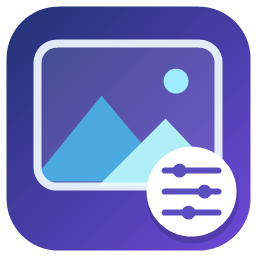

# Codex Wallpaper



为 Windows 上的 Codex 设置自定义图片壁纸，提供桌面设置窗口与配套 skill。

An unofficial Windows wallpaper customizer for Codex, with a desktop settings app and a companion skill.

## 功能

- 选择 PNG、JPEG、WebP 图片，最大 20 MiB。
- 调整明暗、模糊和背景透明度，自动保存并同步。
- 覆盖整个窗口，或仅聊天区域；面板和输入框保持半透明。
- 一键恢复默认外观，保留之前的图片与调节值。
- 在 Codex 中通过 `$codex-wallpaper` 使用聊天指令控制。
- 显示「已保存」「等待同步」「已生效」，核对加载器确认的具体设置版本。

## 环境与兼容性

- Windows 10/11，安装 Codex Windows 桌面应用。
- Node.js 24 或更新版本，`node.exe` 可通过 PATH 找到。
- .NET Framework 的 C# 编译器与 Windows Forms。本项目通过 Windows 自带的 `csc.exe` 构建，无第三方 npm 依赖。

已实际验证的 Codex 版本：商店包 `26.1013.4894.0`，内部版本 `26.1013.40934`。安装目录可自动检测；壁纸样式依赖 Codex 内部界面结构，其他版本可能需要调整 CSS 选择器。

## 从源码使用

下载仓库 ZIP 并解压，或克隆仓库。在项目目录中运行：

```powershell
node --version
powershell.exe -NoProfile -ExecutionPolicy Bypass -File .\scripts\build-app.ps1
```

构建后双击项目目录中的 **Codex 壁纸.exe**：

1. 点击「选图」，选择自己的图片。
2. 调整滑块和应用范围，设置会自动保存。
3. 点击「启动 / 连接 Codex」。首次使用会检测本机商店版 Codex，并验证可执行文件的 OpenAI 签名。
4. 如果 Codex 已从普通入口打开，请从托盘完全退出；加载器会自动重新打开原安装，沿用原来的账号和配置。

以后从设置窗口启动 Codex 即可。设置软件和同目录的 `scripts/` 一起使用；关闭设置窗口不影响已经连接的加载器。

如果自动检测失败，可手动指定 **Codex 安装目录中的**可执行文件：

```powershell
powershell.exe -NoProfile -ExecutionPolicy Bypass -File .\scripts\configure.ps1 -ExecutablePath 'C:\path\to\Codex\ChatGPT.exe'
```

程序要求该文件具有有效的 OpenAI 签名。此命令只记录本机路径，不修改 Codex 安装文件。

## 安装配套 skill 与桌面入口

先完成构建，再双击 **安装桌面入口与Skill.cmd**，或运行：

```powershell
powershell.exe -NoProfile -ExecutionPolicy Bypass -File .\scripts\install-integration.ps1
```

它会创建「Codex 壁纸设置」桌面快捷方式，并把 skill 安装到当前 Codex 用户数据目录的 `skills/codex-wallpaper/`。

在新的 Codex 聊天中使用 `$codex-wallpaper`，例如：

```text
把 Codex 壁纸换成 C:\Pictures\wallpaper.jpg
亮度调到 80%，模糊 4 像素
背景透明度调到 75%，其他不变
恢复 Codex 默认外观
打开壁纸设置软件
```

整体移动软件目录后，重新运行安装命令以更新快捷方式和 skill 位置。

## 命令行

```powershell
node .\scripts\wallpaper.cjs --image 'C:\Pictures\wallpaper.jpg'
node .\scripts\wallpaper.cjs --brightness 0.8 --blur 4 --transparency 75
node .\scripts\wallpaper.cjs --scope window
node .\scripts\wallpaper.cjs --off
node .\scripts\wallpaper.cjs --on
```

背景透明度为 10–100%，值越高壁纸越清楚。图片、滑块、软件与 skill 共用本机 `settings.json`。仓库提供 `settings.example.json`；没有配置文件时会使用默认值。

## 工作方式与限制

加载器启动原安装，在随机本机端口开启 Electron 调试接口，给 `app://-/index.html` 注入样式并检查计算样式。它不会重打包、覆盖或移除 Codex 的程序签名；本项目也不分发 Codex 程序文件。

调试接口只监听 `127.0.0.1`，使用期间其他本机进程可能访问这个接口。需要完全关闭接口时，恢复默认外观、从托盘退出 Codex，再通过其普通入口重新打开。仅点击恢复默认外观会关闭壁纸样式，加载器保持连接以便重新启用。

图片会按窗口大小居中裁切。预览是示意；实际效果以 Codex 窗口为准。Windows Forms 在本机无法解码 WebP 时仍可将其应用到 Codex，但不显示该格式的预览。

本工具为非官方界面定制项目，与 OpenAI 无隶属关系。

## 开发与验证

```powershell
npm test
npm run build
npm run test:ui
npm run test:skill
powershell.exe -NoProfile -ExecutionPolicy Bypass -File .\tests\configure.test.ps1
```

Node.js 测试覆盖设置验证、恢复默认、并发保存、状态版本确认和安装记录。原生界面检查覆盖滑块、中文路径、保存期间的继续修改、恢复默认和 skill 设置同步。检测与 skill 集成检查只在临时目录生成测试配置。

`scripts/runtime.cjs` 负责 CSS 与图片校验；`scripts/live-wallpaper.cjs` 负责本机连接；`scripts/settings-store.cjs` 负责原子保存和进程间互斥；`app/WallpaperApp.cs` 提供设置窗口。

## 公开文件与隐私

仓库只包含源码、原创程序图标、测试、构建脚本和示例配置。请勿提交个人壁纸、聊天截图、账号文件、运行日志或本机安装路径。实际设置、安装记录、skill 位置文件、日志与编译产物均已加入 `.gitignore`。

## License

[MIT](LICENSE)。壁纸图片由使用者自行提供，不包含在此仓库中。
